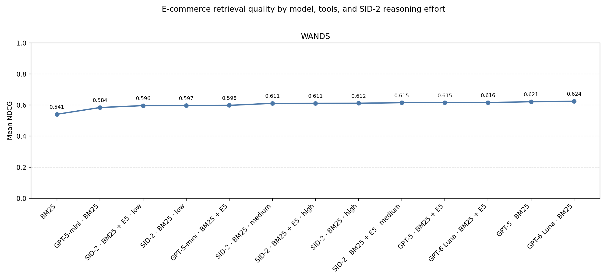
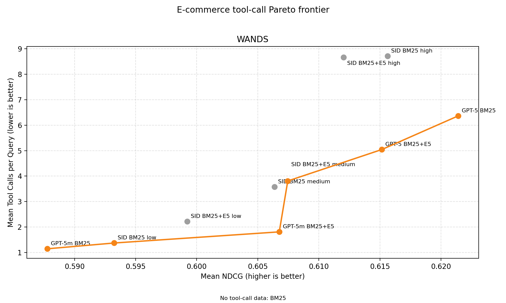
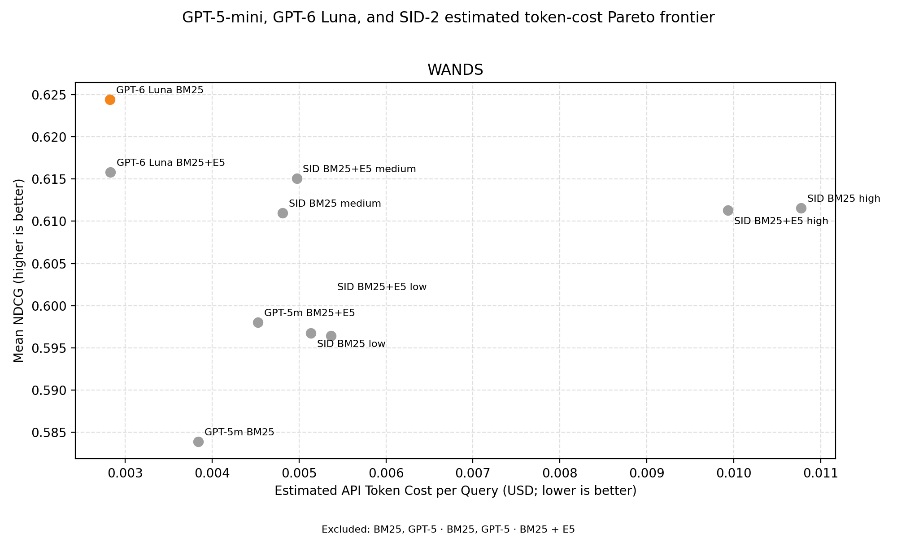
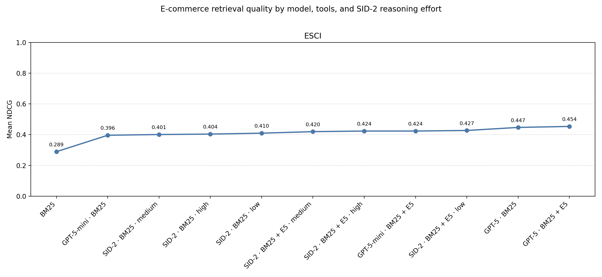
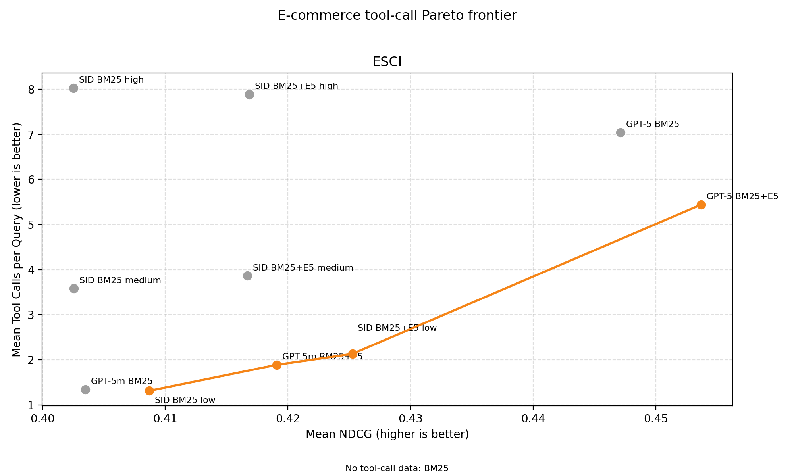
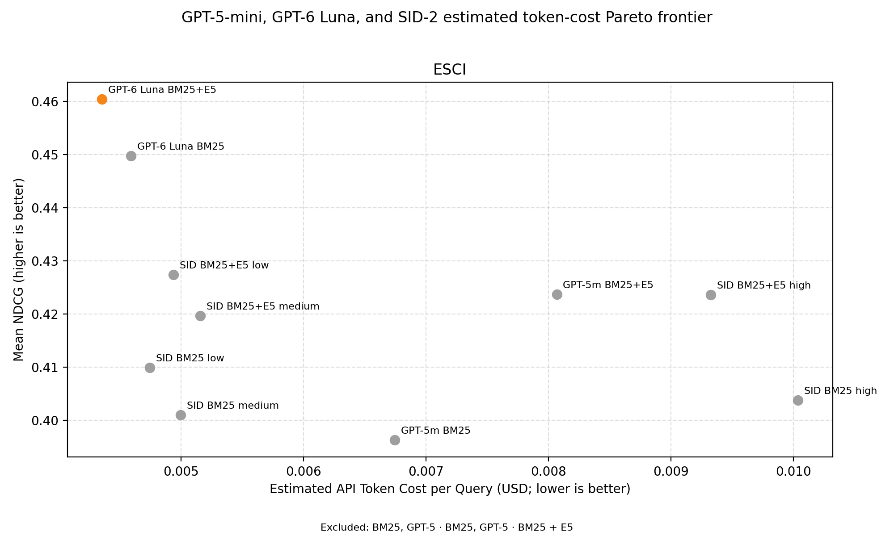

# E-commerce SID-2 search matrix

> **Note:** This report was generated by an LLM.
> 
> These are work-in-progress benchmarks that may not reflect real performance
 
## Summary

This experiment compares BM25, GPT-5, GPT-5-mini, and GPT-6 Luna search agents,
and SID-2 agents using low, medium, or high reasoning. Agent variants use BM25
alone or BM25 with E5-base-v2. Results cover all 480 WANDS queries and a
1,000-query ESCI sample, with seed 42.

In the latest full retrieval run, GPT-6 Luna with BM25 has the highest WANDS
NDCG (0.6244), ahead of GPT-5 with BM25 (0.6214). GPT-6 Luna with BM25+E5 has
the highest ESCI NDCG (0.4605), ahead of GPT-5 with BM25+E5 (0.4537). SID-2's
best results are 0.6151 on WANDS (BM25+E5, medium reasoning) and 0.4274 on ESCI
(BM25+E5, low reasoning).

## Results

### WANDS



The Pareto graph compares GPT-5-mini, GPT-6 Luna, and SID-2 by mean output tokens
per query. Full GPT-5 retrieval metrics remain in the chart and table below, but
are omitted from token Pareto comparisons because those historical runs did not
report token usage.





| Variant | Mean NDCG | Median NDCG | Mean tool calls/query | Median tool calls/query | Mean output tokens/query |
| --- | ---: | ---: | ---: | ---: | ---: |
| BM25 | 0.5408 | 0.4746 | — | — | — |
| GPT-5-mini · BM25 | 0.5839 | 0.5609 | 1.252 | 1.000 | 1161.5 |
| SID-2 · BM25 + E5 · low | 0.5964 | 0.5745 | 2.233 | 2.000 | 596.3 |
| SID-2 · BM25 · low | 0.5967 | 0.5609 | 1.373 | 1.000 | 517.3 |
| GPT-5-mini · BM25 + E5 | 0.5980 | 0.5609 | 1.702 | 2.000 | 1256.5 |
| SID-2 · BM25 · medium | 0.6110 | 0.5935 | 3.648 | 3.000 | 639.3 |
| SID-2 · BM25 + E5 · high | 0.6113 | 0.6119 | 8.419 | 6.000 | 1618.9 |
| SID-2 · BM25 · high | 0.6116 | 0.6027 | 8.679 | 7.000 | 1526.9 |
| SID-2 · BM25 + E5 · medium | 0.6151 | 0.5875 | 3.735 | 4.000 | 720.0 |
| GPT-5 · BM25 + E5 | 0.6152 | 0.6178 | 5.044 | 4.000 | — |
| GPT-6 Luna · BM25 + E5 | 0.6158 | 0.6120 | 3.358 | 3.000 | 462.2 |
| GPT-5 · BM25 | 0.6214 | 0.6368 | 6.365 | 6.000 | — |
| GPT-6 Luna · BM25 | 0.6244 | 0.6264 | 2.025 | 2.000 | 350.7 |

For SID-2 on WANDS, BM25-only NDCG rises from 0.5967 at low to 0.6116 at high
reasoning, while mean calls rise from 1.373 to 8.679. With E5, medium reasoning
has the highest SID-2 NDCG (0.6151); mean calls range from 2.233 at low to 8.419
at high reasoning.

### ESCI







| Variant | Mean NDCG | Median NDCG | Mean tool calls/query | Median tool calls/query | Mean output tokens/query |
| --- | ---: | ---: | ---: | ---: | ---: |
| BM25 | 0.2895 | 0.1707 | — | — | — |
| GPT-5-mini · BM25 | 0.3963 | 0.3414 | 1.503 | 1.000 | 1995.5 |
| SID-2 · BM25 · medium | 0.4010 | 0.3696 | 3.660 | 3.000 | 649.0 |
| SID-2 · BM25 · high | 0.4038 | 0.3691 | 7.932 | 6.000 | 1527.9 |
| SID-2 · BM25 · low | 0.4099 | 0.3955 | 1.304 | 1.000 | 453.4 |
| SID-2 · BM25 + E5 · medium | 0.4197 | 0.3920 | 3.838 | 4.000 | 704.0 |
| SID-2 · BM25 + E5 · high | 0.4236 | 0.4097 | 8.010 | 6.000 | 1648.8 |
| GPT-5-mini · BM25 + E5 | 0.4237 | 0.4097 | 2.051 | 2.000 | 2364.8 |
| SID-2 · BM25 + E5 · low | 0.4274 | 0.4220 | 2.133 | 2.000 | 510.8 |
| GPT-5 · BM25 | 0.4471 | 0.4440 | 7.041 | 7.000 | — |
| GPT-6 Luna · BM25 | 0.4498 | 0.4279 | 2.313 | 2.000 | 474.0 |
| GPT-5 · BM25 + E5 | 0.4537 | 0.4417 | 5.441 | 4.000 | — |
| GPT-6 Luna · BM25 + E5 | 0.4605 | 0.4531 | 3.891 | 4.000 | 629.6 |

For SID-2 on ESCI, low reasoning has the highest NDCG for both tool sets. Adding
E5 raises the low-reasoning score from 0.4099 to 0.4274, with mean tool calls
increasing from 1.304 to 2.133. Medium and high reasoning do not improve on the
low-reasoning scores. GPT-6 Luna reaches 0.4498 with BM25 and 0.4605 with
BM25+E5, the highest ESCI result in this run.

`—` means the run did not report that resource statistic. NDCG values are
rounded to four decimal places; tool-call statistics to three; and output-token
means to one decimal. The retrieval tables, retrieval charts, and token Pareto
charts use the latest full-run results in
[`ecom_sid_matrix.csv`](../results/ecom_sid_matrix.csv). Pareto x-values are mean
`output_tokens` per query, which includes reasoning tokens. Full GPT-5 rows lack
token statistics and are excluded from the token Pareto charts.

The cost Pareto charts estimate model token charges per query from mean input and
output token usage. SID-2 is priced at $0.25/M uncached input tokens, $0.025/M
cached input tokens, and $1.00/M output tokens. GPT-5-mini uses $0.25/M input,
$0.025/M cached input, and $2.00/M output tokens. GPT-6 Luna uses $0.10/M input,
$0.01/M cached input, and $0.50/M output tokens ([OpenAI API
pricing](https://developers.openai.com/api/docs/pricing/)). The results CSV does
not include cached-input token counts, so the estimate prices all input tokens
at the uncached rate; actual token charges may be lower when input caching
applies. Estimates exclude any non-token charges. Historical GPT-5 runs are
omitted because they lack token-usage data.

## Configuration and reproduction

The six SID configurations use `sid/sid-2` with reasoning effort `low`,
`medium`, or `high`, and either BM25 or BM25 plus E5-base-v2:
[`configs/agentic/ecom_sid/`](../../configs/agentic/ecom_sid/). Baselines are configured in
[`configs/ecom_base/`](../../configs/ecom_base/),
[`configs/agentic/agentic_ecom_bm25_gpt5.yml`](../../configs/agentic/agentic_ecom_bm25_gpt5.yml),
and [`configs/agentic/ecom_agentic/`](../../configs/agentic/ecom_agentic/), including the
GPT-5-mini and GPT-6 Luna BM25/BM25+E5 matrix variants.

The machine-readable results are in
[`research/results/ecom_sid_matrix.csv`](../results/ecom_sid_matrix.csv).
The runner uses eight workers by default and seed 42. To regenerate the
retrieval, output-token Pareto, and estimated token-cost Pareto charts from the
full-run CSV without running models:

```bash
uv run python scripts/plot_ecom_sid_matrix.py \
  --input research/results/ecom_sid_matrix.csv \
  --output-prefix assets/ecom_sid_matrix
```

To refresh GPT-5-mini, GPT-6 Luna, and SID results, preserving BM25 and full GPT-5
rows, run:

```bash
RERUN_SID_VARIANTS=true ./scripts/run_ecom_sid_matrix.sh
```

This bypasses result caches for the refreshed strategies. The default runner also
selects GPT-6 Luna for both tool sets on every invocation. It preserves the
historical full GPT-5 rows instead of rerunning them. `NO_CACHE=true` bypasses
result caches for all selected variants and can incur new model API usage.

## Related search learning material

Doug Turnbull's [Maven profile](https://maven.com/softwaredoug/) describes its
Lightning Lessons as free, interactive sessions and lists a wide range of
search topics, including *IR Today: Theory, Practice, and Agents*, *Embeddings
don't solve RAG*, *Neural search at BM25 latency*, *Building Your Agent Indexing
System*, and *High scale agentic memory with Turbopuffer*. The profile also lists
the multi-week [Cheat at Search with Agents
course](https://maven.com/softwaredoug/cheat-at-search). These lessons and
courses provide broader practical search education; this matrix is a focused
measurement of retrieval quality and tool use across a small set of configured
approaches.
